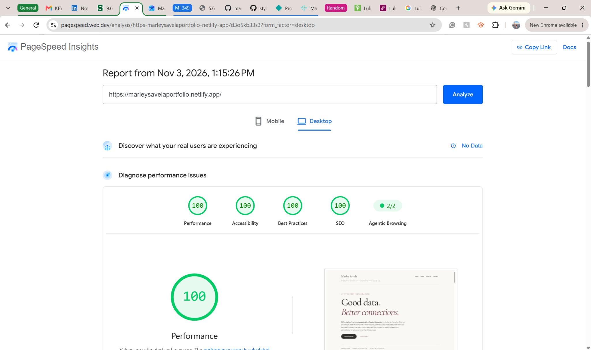

# Accessibility Audit — Portfolio Website

**Website:** https://marleysavelaportfolio.netlify.app/

**Audit tool:** Google PageSpeed Insights (Lighthouse), Desktop

**Audit date shown in report:** November 3, 2026

## Audit results

| Category | Score |
|---|---:|
| Accessibility | **100 / 100** |
| Performance | 100 / 100 |
| Best Practices | 100 / 100 |
| SEO | 100 / 100 |

## Screenshot evidence

## Findings and fixes

The submitted PageSpeed Insights screenshot reports a **100/100 desktop accessibility score**. It does not show individual audit checks or a list of changes made. No specific accessibility bugs or code fixes can be confirmed from this screenshot alone.

## Keyboard navigation verification

Keyboard-only navigation is documented separately in the required 1–2 minute video. Verify visible focus, logical Tab and Shift+Tab order, and Enter activation while recording.
